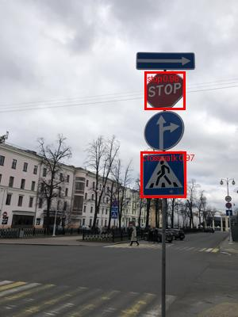
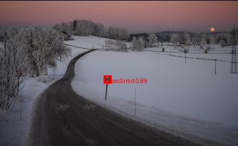
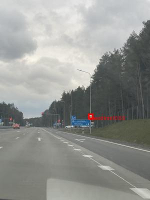

# clone-yolo: tự dựng lại YOLOv8n từ số 0

**Mục tiêu:** viết lại YOLOv8n (bản nhỏ nhất) bằng PyTorch, từng khối một, đến khi model của bạn nhận ảnh
`(1, 3, 640, 640)` và trả ra `(1, 84, 8400)` giống bản gốc. Sau đó (khi đã học xong C1–C3) viết lại bằng C++ / LibTorch.

> **Người mới tiếp nhận:** đọc [docs/README.md](docs/README.md) trước. Ở đó có thứ tự đọc, plan học, trạng thái hiện
> tại, cách cài đặt và các lệnh.

## Kết quả

Model tự viết, fine-tune 100 epoch trên dataset biển báo (Kaggle `andrewmvd/road-sign-detection`, 4 class), chạy trên
3 ảnh của tập val (model chưa thấy khi train). Trên cả 175 ảnh val: **mAP50 0.836, mAP50-95 0.705**.

| `road160` | `road108` | `road239` |
|:---:|:---:|:---:|
|  |  |  |
| `stop 0.98`, `crosswalk 0.97`; bỏ sót một biển crosswalk ~7×9 px ở xa | `speedlimit 0.89`, biển nhỏ 13×12 px | `speedlimit 0.53`, đúng nhưng điểm thấp vì biển rất nhỏ |

Vật nhỏ là điểm yếu chính của model hiện tại. Trọng số ở
[Release v1.0](https://github.com/namnd020304/clone-python-yolo/releases/tag/v1.0); tạo lại ảnh bằng
`python predict.py best.pt datasets/bien-bao/images/val/road160.png` (đổi tên ảnh cho 2 ảnh còn lại).

**Cách làm:** mỗi file trong `yolo/` là một bước. Hàm/lớp đang `raise NotImplementedError`; bạn viết phần thân rồi
chạy chương trình chấm (cài môi trường: [docs/huong-dan/cai-dat-moi-truong.md](docs/huong-dan/cai-dat-moi-truong.md)):

```powershell
python check.py          # chấm tất cả bước
python check.py 1        # chỉ chấm bước 1
```

Chương trình chấm chỉ kiểm tra **shape** và vài con số (số tham số, 8400...). Bước nào chưa viết sẽ báo `chưa làm`.

## Các bước

| Bước | File | Viết gì | Kiểm tra |
|---|---|---|---|
| 1 | [yolo/blocks.py](yolo/blocks.py) | `Conv` = Conv2d + BatchNorm2d + SiLU | `(1,3,640,640)` → `(1,16,320,320)` với stride 2 |
| 2 | [yolo/blocks.py](yolo/blocks.py) | `Bottleneck`, `C2f` | giữ nguyên H, W; đổi số kênh |
| 3 | [yolo/blocks.py](yolo/blocks.py) | `SPPF` (3 lần MaxPool 5×5 nối lại) | giữ nguyên shape |
| 4 | [yolo/backbone.py](yolo/backbone.py) | Backbone: ra 3 mức P3, P4, P5 | `(64,80,80)`, `(128,40,40)`, `(256,20,20)` |
| 5 | [yolo/neck.py](yolo/neck.py) | Neck PAN-FPN: trộn 3 mức lên–xuống | cùng 3 shape như bước 4 |
| 6 | [yolo/head.py](yolo/head.py) | Head tách nhánh box / class, DFL | `(1, 84, 8400)` |
| 7 | [yolo/model.py](yolo/model.py) | Ghép backbone + neck + head | ~3,2 triệu tham số, `(1, 84, 8400)` |
| 8 | [yolo/preprocess.py](yolo/preprocess.py) | Letterbox: resize giữ tỉ lệ + viền xám | ảnh bất kỳ → `(1,3,640,640)` |
| 9 | [yolo/postprocess.py](yolo/postprocess.py) | Lọc theo điểm + NMS | danh sách box `[x1,y1,x2,y2,score,cls]` |

**Sau bước 9 (tuỳ chọn, khó):** nạp trọng số `yolov8n.pt` gốc vào model của bạn để chạy ra box thật trên ảnh; viết
loss (TAL assigner, CIoU, DFL) và train trên dataset nhỏ; port sang LibTorch.

**Giai đoạn 2 (bước 10–16, đã làm):** train model tự viết. Lý thuyết từng bước ở [docs/train/](docs/train/README.md):
dữ liệu, đầu ra thô của head, gán nhãn TAL, loss, vòng lặp train, mAP, dataset Kaggle và train trên cloud.

## Con số cần nhớ (YOLOv8n, ảnh 640)

- `width = 0.25`, `depth = 0.33`: kênh gốc 64/128/256/512/1024 nhân 0.25 → **16/32/64/128/256**; số lần lặp C2f
  3/6/6/3 nhân 0.33 → **1/2/2/1**.
- 3 mức đầu ra với stride 8, 16, 32 → lưới 80×80 + 40×40 + 20×20 = **8400** ô (chính là con số trong `03_control.cpp`).
- Mỗi ô dự đoán 4 toạ độ + 80 điểm class = **84**.

## Học song song

| Tuần C++ | Bước clone-yolo nên làm |
|---|---|
| C1 (biến, `for`, hàm, `vector`) | 1–3: tensor, shape, khối Conv / C2f / SPPF |
| C2 (`struct Box`, IoU, sort) | 4–7 và 9: ghép model, NMS (so với IoU bạn viết bằng C++) |
| C3 (bộ nhớ, HWC → CHW) | 8: letterbox, `permute` HWC → CHW |

## Tài liệu

- Kiến trúc: [Ultralytics YOLOv8 docs](https://docs.ultralytics.com/models/yolov8/), file cấu hình gốc
  `ultralytics/cfg/models/v8/yolov8.yaml` trên GitHub.
- PyTorch: [Learn the Basics](https://docs.pytorch.org/tutorials/beginner/basics/intro.html),
  [`torch.nn`](https://docs.pytorch.org/docs/stable/nn.html).
- Chỉ đọc code của Ultralytics **sau khi** bước tương ứng đã qua chương trình chấm, để so cách viết.
